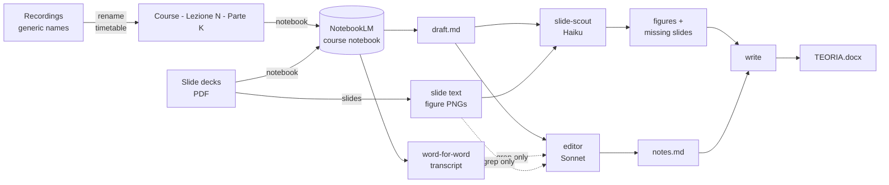

# lecture-notes-pipeline

From a two-hour lecture recording to finished study notes in the course's Word document, with one command: `/lecture 6 economia aziendale`.

I record every lecture of my master's degree in Management Engineering at Politecnico di Torino. Turning those recordings into notes used to be a manual chain: rename the files, upload them to NotebookLM, ask for a transcript, paste it into a chat, merge it with the slides, copy charts and tables by hand into Word. This repo automates the whole chain. It also handles a second recurring job: photos of a classmate's handwritten exercises, turned into clean exercises with proper T-accounts.

The design constraint was **cost**. The heavy work, transcribing hours of audio and writing a first draft, is done by NotebookLM, which is free on a student plan. Claude Code subagents only do what NotebookLM is bad at: picking the right figures, checking numbers against slides and transcript, and writing in the exact style of the existing notes. Everything mechanical is a plain Python script.

## How it works



| Step | Command | Who does it | Claude tokens |
|---|---|---|---|
| Name new recordings | `lecture-notes rename --apply` | script | 0 |
| Upload, transcript, draft | `lecture-notes notebook COURSE N` | NotebookLM | 0 |
| Slide text and figure renders | `lecture-notes slides COURSE N` | script (PyMuPDF) | 0 |
| Figures and missing slides | `slide-scout` agent | Claude Haiku | low |
| Final notes | `editor` agent | Claude Sonnet | medium |
| Append to Word | `lecture-notes write COURSE N notes.md` | script (python-docx) | 0 |
| Handwritten exercises | `lecture-notes photos` + `scribe` agent | Claude Sonnet (vision) | medium |

The two slash commands that tie it together live in [`claude/skills`](claude/skills), the three subagents in [`claude/agents`](claude/agents).

## First real run

Lecture 6 of *Economia Aziendale* (taxes and timing differences, leasing, bonds): two recordings of 114 MB and 85 MB, and a 118-page slide deck.

- Upload, transcription and draft: **about 7 minutes**, all on NotebookLM's side. The draft was 6,190 words with worked examples.
- `slide-scout` (Haiku): about 80k tokens, 24 s. `editor` (Sonnet): about 110k tokens, 1 min 48 s.
- Result: 4,664 words appended as chapters 30.3-32, with three slide figures and every T-account rebuilt as a Word table. The existing "summary of formulas" chapter moved from 31 to 33, so it stays last.
- The editor corrected or completed five points of the draft by checking slides and transcript: a wrong pre-tax income, an unbalanced tax account, an incomplete accrual, a missing year of bond-premium amortisation and an interest figure rounded differently from the slides.

**Renaming from the timetable:** checked against the 31 recordings I had already named by hand. All 31 got the right course.

## What did not work, and what replaced it

- **Asking NotebookLM's chat for a transcript.** The chat summarises, however precise the prompt is. What works is the indexed full text of the audio source itself (`source fulltext`): it is verbatim, hesitations included.
- **Uploading with the notebooklm-py CLI on Windows.** The CLI switches to `WindowsSelectorEventLoopPolicy`. With that event loop, large uploads die with `AssertionError: Data should not be empty` and the source stays in "preparing" forever. [`_nlm.py`](src/lecture_notes/_nlm.py) runs the same CLI on the default Proactor loop, and 130 MB recordings upload fine.
- **Trusting NotebookLM's slide numbers.** In the first run the draft pointed to slides 29 and 38: the right ones were 94 and 106. The draft now cites slide *titles*, and the slide-scout greps them in the extracted text.
- **Guessing the course from the first minutes of audio.** It costs a transcription and tokens for something the timetable already says. Recording start = file time − duration, and the slot that contains the midpoint wins. Phone recordings received from classmates carry the download time, so their timestamp is read from the file name (`Voce 261013_132552`).
- **A page-is-a-figure heuristic on its own.** Raster images or more than 25 vector drawings flagged 68 of 118 pages, because tables and boxes count as drawings. It is now only the pool of candidates the slide-scout picks from.

## Setup

Requirements: Python 3.11+, `ffprobe` (from FFmpeg) on the PATH, a Google account with NotebookLM, and [Claude Code](https://claude.com/claude-code) for the agent steps.

```bash
python -m venv .venv
.venv\Scripts\activate        # Linux/macOS: source .venv/bin/activate
pip install -e ".[dev]"
notebooklm login              # Google sign-in in a browser window, once
```

Copy `config.example.toml` to `~/.lecture-notes/config.toml` and set:
- the recordings folder and the course folders (one folder per course, holding its slide PDFs and the notes document);
- the courses, with their aliases and NotebookLM notebook titles;
- the weekly timetable.

To use the slash commands, copy `claude/skills/*` into `.claude/skills/` and `claude/agents/*` into `.claude/agents/` of the folder where you run Claude Code.

## Running it on an always-on server

I run Claude Code 24/7 on a small Linux box, behind a Telegram bot, so `/lecture` also works from my phone with the PC switched off. The pipeline itself needs no changes: only the paths in the server's `config.toml` differ.

- **Files.** Three folders are synced from the PC with [Syncthing](https://syncthing.net): the recordings, the course folders and the PC's Downloads (where photos from WhatsApp land). Recordings that live in OneDrive must be set to "always keep on this device", or Syncthing only sees placeholders.
- **Word open on the PC.** `write` refuses to touch a document that Word has open, by looking for Word's `~$` lock file. Don't put `~$*` in `.stignore`: syncing the lock file is what lets the server see that the document is open on the PC.
- **Login.** NotebookLM is reached with a Google session saved by `notebooklm login`, which needs a browser. Sign in on the PC and copy `~/.notebooklm/profiles/default/storage_state.json` to the server (mode 600). That file is a live Google session, so only do this on a machine you trust.
- **Expired login.** `lecture-notes auth` exits with 1 when the session has expired. [`scripts/check-auth.sh`](scripts/check-auth.sh) runs it every morning from a systemd timer and sends a Telegram warning. [`scripts/login-and-push.ps1`](scripts/login-and-push.ps1), behind a desktop shortcut, signs in again on the PC, copies the session to the server and confirms on Telegram.

```ini
# ~/.config/systemd/user/notebooklm-auth.timer   (plus a oneshot .service running check-auth.sh)
[Timer]
OnCalendar=*-*-* 07:45
Persistent=true
[Install]
WantedBy=timers.target
```

## Conventions it relies on

- Recordings are named `<Course> - Lezione N - Parte K.m4a` (the renamer produces exactly this).
- The notes document uses Word's built-in `Heading 1` and `Heading 2` styles, numbered `31.` and `31.2`, and may end with a summary chapter that must stay last (`summary_heading` in the config).
- T-accounts are written by the agents as `MASTRINO:` / `DARE:` / `AVERE:` lines and become a two-column table with a merged title row.

## Tests

```bash
pytest
```

They cover:
- timetable matching, including phone timestamps and lecture and part numbering;
- the Word writer: numbering that continues an existing chapter, the summary chapter kept last, Markdown tables and T-accounts, the backup.

## Limits

- notebooklm-py uses undocumented Google APIs, so a change on Google's side can break the `notebook` step until the library is updated.
- The Google session expires every few weeks and can only be renewed from a machine with a browser.
- The renamer needs a fixed timetable. Make-up lectures or moved slots are reported as "outside the timetable" and named by hand.
- The prompts and Markdown conventions assume Italian lectures and Italian accounting (Dare/Avere). Other languages need a new draft prompt in [`notebooklm.py`](src/lecture_notes/notebooklm.py).

## License

MIT
